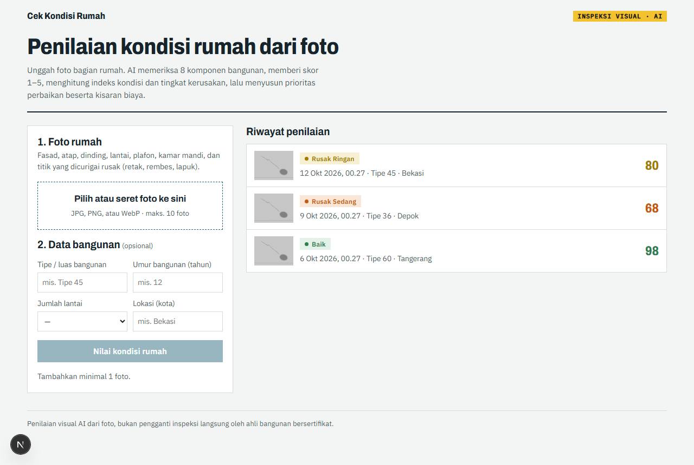
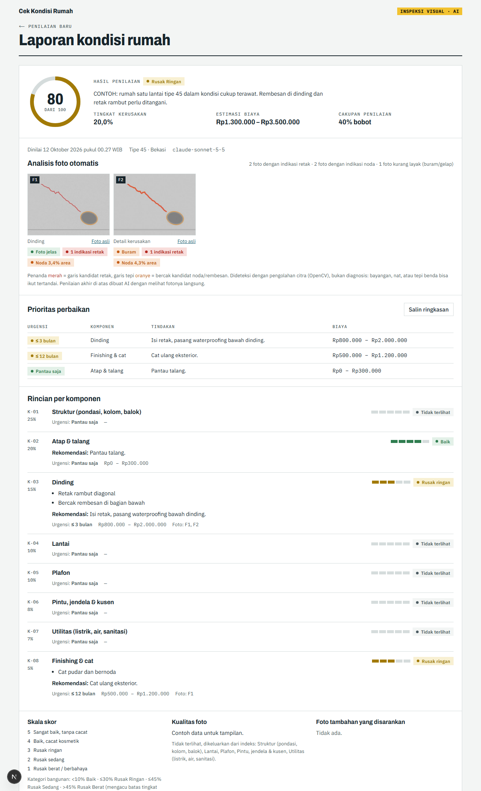

# Home Condition Assessment

Assess a home's condition from photos. The AI reviews eight building components and assigns scores from 1 to 5. The application calculates a weighted condition index and damage category, and presents repair priorities with indicative cost ranges. The full web application saves reports to assessment history.

## Language and compatibility

The application interface, new AI-generated report text, service messages, and project documentation are in English. Existing database/API field names and status codes remain unchanged for compatibility; the interface maps legacy room labels to English when displaying them. Reports saved before the language update may still contain Indonesian AI-generated text.

## English Streamlit demo

The repository also includes a simplified Streamlit app for photo-based assessments. It reuses the Python/OpenCV analyzer and provides an AI-generated report, condition index, repair-cost estimates, and a JSON download. Reports are held in the current Streamlit session; the demo does not include persistent history, dataset-labeling tools, or 3D scanning.

The demo accepts up to 10 JPG, PNG, or WebP photos, with a 5 MB limit per photo. It uses Anthropic directly; unlike the full web app, it does not use Vercel AI Gateway. The key can be entered in the sidebar or configured as `ANTHROPIC_API_KEY`. Optional `ANTHROPIC_MODEL` and `ANTHROPIC_BASE_URL` settings can be provided as environment variables or Streamlit secrets.

Run locally with Python 3.11 or newer:

```powershell
python -m venv .venv
.venv\Scripts\Activate.ps1
pip install -r requirements.txt
$env:ANTHROPIC_API_KEY = "your-api-key"
streamlit run streamlit_app.py
```

For Streamlit Community Cloud, set `ANTHROPIC_API_KEY` in the app's Secrets settings. Optional secrets are `ANTHROPIC_MODEL` and `ANTHROPIC_BASE_URL`. The Streamlit entry point is `streamlit_app.py`. Treat uploaded photos and building details as sensitive: they are sent to the configured Anthropic endpoint for assessment. Configure provider access and review its data-handling terms before deployment.

## Screenshots

Home page with assessment history:



Assessment report with condition index, photo analysis, repair priorities, and component details. Screenshot data is illustrative:



## Run the full web application

1. Copy `.env.example` to `.env.local` and configure **one** AI provider:
   - `AI_GATEWAY_API_KEY` (Vercel AI Gateway), or
   - `ANTHROPIC_API_KEY` (direct Anthropic access).
2. Start the web application:

   ```bash
   npm install
   npm run dev
   ```

3. (Optional) Start the Python photo-analysis service in another terminal. Python 3.11 or newer and [uv](https://docs.astral.sh/uv/) are required:

   ```bash
   npm run analyzer
   ```

   The service runs at http://127.0.0.1:8000 (`ANALYZER_URL`). Without it, assessment still works without automated image analysis.
4. Open http://localhost:3000.

The local SQLite database is created automatically at `data/penilaian.db`.

## How it works

```text
Browser: select photos → resize to JPEG, 1568 px + 360 px thumbnails
   │  POST /api/penilaian (multipart)
   ▼
Server: validate
   → optional Python/OpenCV analysis (photo quality, crack/stain indicators, overlays)
   → AI assessment (structured output; image-analysis results are hints)
   → normalize → calculate → save
   ▼
/penilaian/[id]: report
```

### Automated photo analysis (Python)

The `analyzer/` folder contains a FastAPI + OpenCV service using classical heuristics without a trained model:

| Check | Method |
| --- | --- |
| Photo quality | Sharpness ratio (photo gradient compared with a blurred version), brightness, and resolution → `baik`, `agak_buram`, `buram`, `gelap`, `terlalu_terang`, `resolusi_rendah` |
| Crack indicators | Morphological black-hat highlights thin dark lines → remove long, straight horizontal/vertical lines (grout, frames) → retain elongated components |
| Stain / leak indicators | Detect patches darker than their estimated surroundings on bright surfaces |

Results are used as AI prompt hints and displayed as markers in the report (red for possible cracks, orange outlines for possible stains). Thresholds are in `analyzer/analisis.py`. Current tests use synthetic images; tune and evaluate against real home photos before relying on the results.

```bash
npm run test:analyzer
```

- **AI returns component scores and findings only.** Derived numbers (index, damage percentage, category, and total cost) are calculated by `src/lib/penilaian.ts`.
- Component weights: structure 25, roof 20, walls 15, flooring 10, ceiling 10, doors/windows 8, utilities 7, finishes 5.
- Score-to-damage mapping: 5 → 0%, 4 → 10%, 3 → 30%, 2 → 55%, 1 → 85%. Invisible components are excluded and the remaining weights are renormalized.
- The index and category are withheld when less than 50% of component weight is visible. Categories: <10% Good, ≤30% Minor damage, ≤45% Moderate damage, >45% Severe damage.

### Damage detection model (optional RF-DETR)

The damage detector can be trained on photos annotated using the dataset tool. When installed, it replaces heuristic crack/stain markers, provides AI prompt hints, and suggests labels for new photos. It uses RF-DETR Nano–Large ([Apache 2.0](https://github.com/roboflow/rf-detr)); XL/2XL are excluded because they use a different license (PML).

Classes (fixed order; see `src/lib/kelas-kerusakan.ts`): cracks, water stains/leaks, mold/mildew, peeling paint, damaged plaster, rust, wood rot/termite damage, damaged tile, damaged ceiling.

1. **Collect and label photos** at http://localhost:3000/dataset. Crack and leak box suggestions are generated when the analyzer is running. Shortcuts: `1`–`9` select a class, `Del` deletes a box, `A` accepts suggestions, `Enter` saves and continues, `Ctrl+Z` undoes. As a starting point, aim for about 100 boxes per class from a diverse range of homes. Include undamaged photos without boxes.
2. **Export** using the dataset page. Files are written to `data/dataset/ekspor/{train,valid,test}` in COCO format with a stable 80/10/10 split.
3. **Train** on a Modal GPU (Modal account required):

   ```bash
   cd detector
   uv sync
   uv run modal run modal_app.py --ukuran small --epochs 60
   ```

   The model is saved to `analyzer/model/kerusakan.pth` with `kerusakan.json`. For a small CPU smoke test (slow; checks that the pipeline runs):

   ```bash
   uv run python latih.py --ukuran nano --epochs 1 --device cpu --keluar <test-folder>
   ```

4. **Enable** the model in the analysis service:

   ```bash
   cd analyzer
   uv sync --extra deteksi
   ```

   Restart `npm run analyzer`. Check model status at http://127.0.0.1:8000/sehat.

The dataset tool has no login. It is disabled in production unless `DATASET_AKTIF=1`. Dataset photos are stored locally in `data/dataset/` and are not committed to Git.

### 3D scanning (optional Gaussian Splatting)

On an assessment report, users can upload a 10–90 second video of a room. The video is converted to a 3D Gaussian Splatting model that can be rotated and zoomed in the report. **This is for visualization only and does not affect the score, index, or category.**

```text
Browser ──upload video──▶ Vercel Blob
   │ POST /api/pemindaian
   ▼
Modal (L4 GPU): ffmpeg → discard blurry frames → COLMAP → gsplat (MCMC, max. 400k Gaussians) → compressed PLY
   ▲ GET /api/pemindaian/[id] (polled every 10 seconds)
   │ on completion: save result to Vercel Blob → Spark (three.js) viewer in report
```

To enable:

1. Create a Vercel Blob store and set `BLOB_READ_WRITE_TOKEN` in `.env.local`.
2. Deploy the worker to Modal (Modal account required):

   ```bash
   cd splat
   uv sync
   uv run modal token new
   uv run modal secret create cek-rumah-splat SPLAT_TOKEN=<long-random-token>
   uv run modal deploy app.py
   ```

3. Set `MODAL_SPLAT_URL` to the deployed `mulai` endpoint URL, and set `SPLAT_TOKEN` to the same token.
4. Restart `npm run dev`.

Notes:
- Modal charges for GPU usage. `MAKS_PEMINDAIAN_HARIAN` (default 5) limits jobs per 24 hours because the application does not have user accounts.
- Videos and 3D models are stored as public blobs with random names. Anyone with a URL can access the corresponding blob.
- Test pipeline steps without a GPU: `cd splat && uv run pytest`.

## Project structure

| File / folder | Purpose |
| --- | --- |
| `src/lib/penilaian.ts` | Components, weights, scales, calculations, and AI-output normalization |
| `src/lib/ai.ts` | AI prompt, Zod schema, and model call |
| `src/lib/db.ts` | libSQL / SQLite persistence |
| `src/lib/analisis.ts` | Python analysis-service client |
| `analyzer/analisis.py` | OpenCV image analysis |
| `analyzer/main.py` | FastAPI API (`POST /analisis`, `GET /sehat`) |
| `analyzer/deteksi.py` | Optional RF-DETR inference |
| `detector/latih.py`, `detector/modal_app.py` | RF-DETR training (local CPU / Modal GPU) |
| `src/lib/kelas-kerusakan.ts`, `src/lib/dataset.ts` | Damage classes, dataset persistence, and COCO export |
| `src/app/dataset/`, `src/components/AlatLabel.tsx` | Dataset pages and labeling tool |
| `splat/app.py` | Modal worker for 3D scanning (GPU image, `mulai` and `status` endpoints) |
| `splat/pipeline.py` | Frame selection, validation, and COLMAP/gsplat commands |
| `src/lib/splat.ts` | Modal worker client |
| `src/components/Pemindaian3D.tsx`, `ViewerSplat.tsx` | Video upload, status, and 3D viewer |
| `src/app/api/penilaian/route.ts` | Assessment endpoint |
| `src/components/FormPenilaian.tsx` | Photo upload and building details |
| `src/components/Laporan.tsx` | Report display |
| `prototipe/` | Early single-file HTML prototype |

## Deployment

On serverless hosting (such as Vercel), local SQLite files are not persistent. Set `DATABASE_URL` and `DATABASE_AUTH_TOKEN` to a libSQL database (such as Turso); no code changes are required.

Deploy the Python service separately (for example, as a container running `uv run uvicorn main:app --host 0.0.0.0`) and set `ANALYZER_URL` to its address. The service does not include authentication; keep it on a private network or add a token before exposing it publicly.

## MVP limitations

- There are no user accounts, so all users share the same assessment history and request limits are not enforced. Add authentication and rate limits before public launch.
- Repair costs are AI estimates and are not based on a verified unit-price catalog.
- Original photos are not retained by the assessment history; only thumbnails are stored.
- HEIC (iPhone photo) is not supported. Use JPG, PNG, or WebP.
- Historical reports created before the English-language update may still contain Indonesian AI-generated text.
